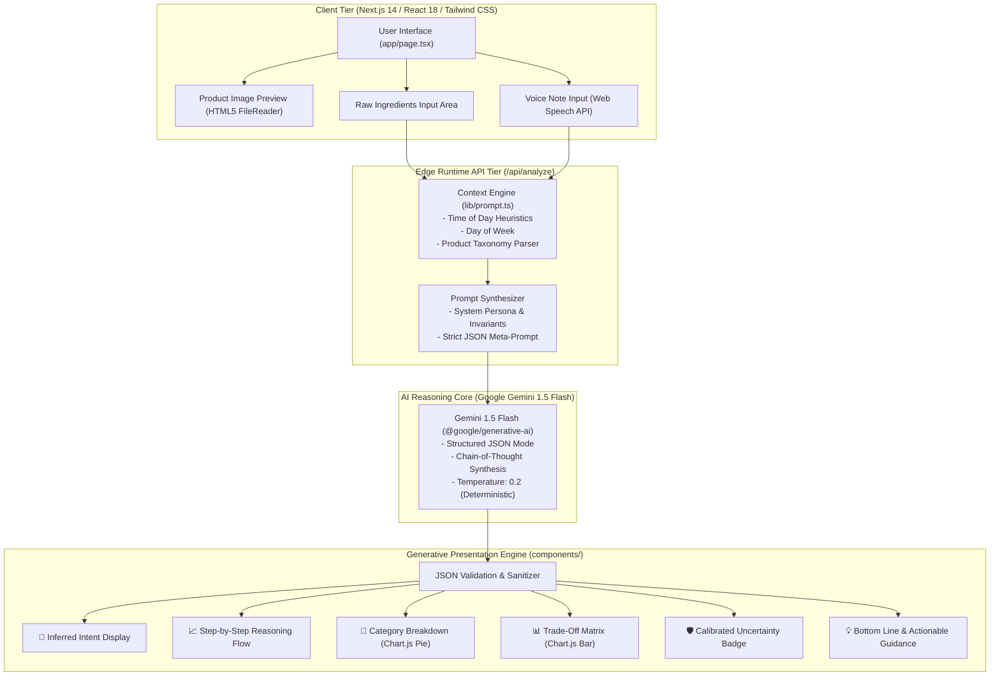
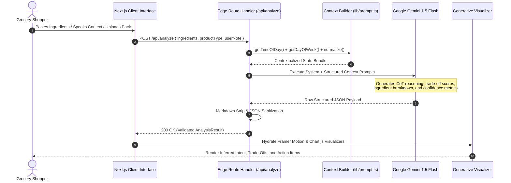

# 🔍 Ingredient Insight AI
### Intelligent Nutrition Detective & AI-Native Food Label Co-Pilot

<div align="center">

[](https://udgam-iitg.in)
[](https://thesys.dev)
[](https://nextjs.org)
[](https://www.typescriptlang.org)
[](https://tailwindcss.com)
[](https://aistudio.google.com)
[](https://www.chartjs.org)
[](LICENSE)
[](https://github.com/SparkSidd)

**Transforming compliance-oriented food packaging into instant, explainable, and context-aware consumer intelligence at decision moments.**  
*Implicit Intent Inference · Zero-Form UX · Chain-of-Thought Nutritional Reasoning · Multi-Tier Calibrated Uncertainty · Dynamic Generative UI*

[Executive Summary](#-problem-context--executive-summary) • [System Architecture](#-system-architecture) • [AI Reasoning Pipeline](#-ai-reasoning-pipeline--prompt-architecture) • [EnCode 2026 Alignment](#-encode-2026-hackathon-alignment) • [Interactive UI & Features](#-interactive-ui--feature-matrix) • [Quick Start](#-quick-start) • [API Reference](#-api-reference)

</div>

---

## 📌 Problem Context & Executive Summary

### The Food Label Comprehension Crisis
Food packaging labels are legally mandated for **regulatory compliance**, not consumer understanding. Every day, billions of grocery shoppers make rapid micro-decisions while navigating an opaque web of industrial food chemistry:
- **Obfuscated Nomenclature**: Preservatives and emulsifiers hide behind chemical designations, INS/E-numbers, or vague umbrella categories (e.g., *"Natural Flavors"* can encompass over 100 chemical distillates).
- **Misleading Health Claims**: Packaged juices boldly tout *"100% Vitamin C"* while concealing $12\text{ g}/100\text{ mL}$ of free sugars and carcinogenic precursor combinations (e.g., Sodium Benzoate paired with Ascorbic Acid forming benzene under light exposure).
- **High-Friction Consumer Tools**: Existing nutrition applications (such as MyFitnessPal or database browsers) act as passive ledger systems. They demand tedious manual input, barcode scanning with poor fallback, rigid questionnaire forms, and raw data dumps that shift the cognitive burden onto the user.

```
┌────────────────────────────────────────────────────────────────────────────────────────┐
│                      THE COMPLIANCE VS. COMPREHENSION CHASM                           │
├────────────────────────────────────────────────────────────────────────────────────────┤
│ TRADITIONAL PARADIGM:                                                                  │
│ [Cryptic Label] ──► [Manual Search/Scan] ──► [Raw Nutrient Table] ──► [User Confusion] │
│                                                                                        │
│ INGREDIENT INSIGHT AI (AI-NATIVE PARADIGM):                                            │
│ [Product Context] ──► [Autonomous Intent Engine] ──► [Visible CoT Reasoning]          │
│                                                   └──► [Generative Charts & Guidance]  │
└────────────────────────────────────────────────────────────────────────────────────────┘
```

### The AI-Native Paradigm Shift
**Ingredient Insight AI** was engineered from the ground up for **EnCode 2026 (UDGAM 2026 @ IIT Guwahati, in association with Thesys)** to redefine how humans interact with nutritional data. 

Rather than treating Artificial Intelligence as a chatbot sidebar or autocomplete add-on, **AI is the interface**:
1. **Zero-Form Intent Inference**: The system eliminates configuration wizards and filter forms. It automatically captures environmental context (time of day, day of week, product category, optional ambient voice notes) to deduce the consumer's situational goal (e.g., *“Fast post-workout carbohydrate replenishment”* vs. *“Low-glycemic family breakfast”*).
2. **Transparent Multi-Step Reasoning**: Exposes the AI's internal chain-of-thought, breaking down ingredient functionality, physiological impacts, and metabolic trade-offs step-by-step.
3. **Calibrated Scientific Uncertainty**: Acknowledges the limits of nutritional science through explicit confidence indicators (High, Medium, Low) and highlights emerging scientific debates.
4. **Dynamic Generative Interface**: Replaces static, hardcoded dashboard layouts with runtime-generated Chart.js breakdowns, multi-attribute trade-off radar/bar matrices, and contextual action points.

---

## 🏛️ System Architecture

Ingredient Insight AI utilizes an edge-first, decoupled architecture built on **Next.js 14 App Router**, executing on the **Vercel Edge Runtime** for sub-100ms cold starts and near-zero server overhead.



### End-to-End Execution Sequence



---

## 🧠 AI Reasoning Pipeline & Prompt Architecture

The core of Ingredient Insight AI is an intent-first cognitive pipeline designed to perform deep chemical and dietary reasoning without requiring the user to formulate complex prompts.

### 1. Context Formulation & Temporal Heuristics
Human dietary needs vary heavily based on chronobiology and situational stressors. The context builder extracts ambient signals to seed the reasoning engine:

$$\text{Context} = \Big\langle \mathcal{T}_{\text{day}}, \, \mathcal{D}_{\text{week}}, \, \mathcal{C}_{\text{product}}, \, \mathcal{V}_{\text{voice\_note}} \Big\rangle$$

```typescript
// Temporal heuristic resolution in lib/prompt.ts
export function getTimeOfDay(): string {
  const hour = new Date().getHours();
  if (hour < 6) return 'Late Night';
  if (hour < 12) return 'Morning';
  if (hour < 17) return 'Afternoon';
  if (hour < 21) return 'Evening';
  return 'Night';
}
```

* **Morning Execution**: Biases analysis toward sustained energy, glycemic index, macronutrient distribution, and artificial sweetener jitter risks.
* **Afternoon Execution**: Evaluates quick rehydration efficiency, caffeine crashes, and post-lunch lethargy triggers.
* **Late Night Execution**: Flags sleep-disruptive stimulants, heavy preservative loads, and digestive irritants.

### 2. Multi-Step Chain-of-Thought (CoT) Reasoning Flow
The model is instructed to output an explicit 4-to-5 step reasoning array visible directly to the consumer:
1. **Context & Intent Framing**: Evaluates why the consumer is inspecting this item at this particular time.
2. **Ingredient Functionality Mapping**: Deconstructs every component into its technical food science role (e.g., pH buffer, antioxidant, emulsifier, synthetic dye).
3. **Compound Synergy & Antagonism**: Identifies hazardous or beneficial chemical interactions (e.g., Sodium Benzoate $+$ Ascorbic Acid, or Bioflavonoid $+$ Vitamin C synergies).
4. **Trade-Off Scoring**: Quantifies the real-world tension across 4 cardinal vectors: **Nutritional Value**, **Cost Efficiency**, **Shelf Life Extension**, and **Naturalness**.
5. **Scientific Uncertainty Grading**: Evaluates whether warnings stem from consensus regulatory declarations (FDA, EFSA, WHO) or preliminary animal/in-vitro studies.

### 3. Strict JSON Contract & Type Interface

```typescript
export interface AnalysisResult {
  intent: string;
  reasoning: string[];
  insights: {
    breakdown?: { labels: string[]; values: number[] };
    tradeoffs?: { labels: string[]; values: number[] };
    keyPoints: string[];
    concerns: string[];
    positives: string[];
  };
  uncertainty: {
    overall: 'high' | 'medium' | 'low';
    notes: string[];
  };
  summary: string;
  actions: string[];
}
```

---

## 📊 Dynamic Visualizations & Generative UI

Ingredient Insight AI avoids pre-baked, static dashboard templates. Every analysis dynamically computes chart geometry and rendering attributes based on the generated semantic breakdown.

### Component Suite Overview

| Component | Technology | Primary Functionality | Dynamic Capabilities |
| :--- | :--- | :--- | :--- |
| **`IngredientInput`** | React + Lucide + Web Speech API | Multimodal context ingestion | Image preview, continuous speech-to-text transcription, one-click sample loader |
| **`InsightDisplay`** | Framer Motion + Tailwind | Orchestrator for generative presentation | Staggered entrance animations, collapsible scientific citations, contextual badge styling |
| **`PieChart`** | `react-chartjs-2` + `Chart.js` | Functional ingredient composition | Dynamic 8-color palette mapping, auto-percentage normalization, tooltips |
| **`BarChart`** | `react-chartjs-2` + `Chart.js` | 4-Axis Trade-Off matrix scoring | Real-time threshold color-coding (Green $\ge 7$, Amber $4\text{--}6$, Red $\le 3$) |
| **`UncertaintyBadge`** | React + Tailwind Badge | Scientific consensus indicator | Triple-tier calibrated confidence indicators (`High Confidence`, `Moderate`, `High Uncertainty`) |

### Visual Trade-Off Scoring Logic

$$\text{Color}(S) = \begin{cases} 
\text{Emerald Green (\#22c55e)}, & S \ge 7 \\ 
\text{Amber Yellow (\#f59e0b)}, & 4 \le S < 7 \\ 
\text{Crimson Red (\#ef4444)}, & S < 4 
\end{cases}$$

```text
[Nutritional Value]  █████████░░  4.5 / 10  (Amber - High added sugars offset real fruit content)
[Cost Efficiency]    ████████████ 9.0 / 10  (Green - Low production cost concentrate)
[Shelf Life]         ████████████ 9.5 / 10  (Green - Double benzoate/sorbate stabilization)
[Naturalness]        ████████░░░░ 3.5 / 10  (Red - Synthetic preservatives & artificial acidity)
```

---

## 🏆 EnCode 2026 Hackathon Alignment

Developed specifically for **EnCode 2026** during **UDGAM 2026 at IIT Guwahati**, in collaboration with **Thesys**, Ingredient Insight AI was engineered to address the specific evaluation rubrics of the AI-Native track:

```
┌────────────────────────────────────────────────────────────────────────────────────────┐
│                        ENCODE 2026 EVALUATION RUBRIC CRITERIA                         │
├────────────────────────────────────────┬───────────┬───────────────────────────────────┤
│ Evaluation Dimension                   │ Weight    │ Ingredient Insight AI Evidence    │
├────────────────────────────────────────┼───────────┼───────────────────────────────────┤
│ 1. AI-Native Experience & Ergonomics   │ **50%**   │ • Zero configuration forms        │
│                                        │           │ • Ambient temporal inference      │
│                                        │           │ • Web Speech API voice capture    │
│                                        │           │ • Adaptive Generative UI          │
├────────────────────────────────────────┼───────────┼───────────────────────────────────┤
│ 2. Reasoning, Grounding & Explainability│ **30%**   │ • Exposed 4-step CoT reasoning    │
│                                        │           │ • GRAS & WHO limit benchmarking   │
│                                        │           │ • 3-Tier uncertainty telemetry    │
│                                        │           │ • Multi-attribute trade-off matrix│
├────────────────────────────────────────┼───────────┼───────────────────────────────────┤
│ 3. Technical Excellence & Stability    │ **20%**   │ • Next.js 14 App Router           │
│                                        │           │ • Strict TypeScript compilation   │
│                                        │           │ • Edge runtime deployment         │
│                                        │           │ • Zero-crash fallbacks + mock suite│
└────────────────────────────────────────┴───────────┴───────────────────────────────────┘
```

### Why It Excels in the AI-Native Category
- **No Form Fatigue**: Traditional applications require users to select their dietary preferences, allergies, calorie targets, and time horizons through tedious dropdowns. Ingredient Insight AI infers these constraints automatically from temporal heuristics and natural language context notes.
- **Reasoning as Core Content**: Instead of hiding AI execution behind a generic spinner and presenting an opaque rating score (e.g., *"Rating: 62/100"*), our system showcases the intermediate deduction steps, enabling users to evaluate the rationale themselves.
- **Honest Communication of Uncertainty**: Prevents AI hallucination and consumer overconfidence by distinguishing between indisputable chemical facts (e.g., ascorbic acid content) and unresolved epidemiological debates (e.g., long-term microbiome impacts of synthetic emulsifiers).

---

## 💻 Tech Stack & Architectural Justifications

| Layer | Technology | Version | Engineering Rationale |
| :--- | :--- | :--- | :--- |
| **Framework** | **Next.js** | `^14.2.0` | Hybrid App Router architecture with Edge API routes for instantaneous cold starts and zero-maintenance global deployment. |
| **Language** | **TypeScript** | `^5.3.0` | Comprehensive interface typing ensuring contract synchronization between AI JSON generation and React presentation components. |
| **Styling** | **Tailwind CSS** | `^3.4.0` | Utility-first, purgeable design system with custom brand color palettes and micro-interaction animations. |
| **AI Engine** | **Google Gemini 1.5 Flash** | `^0.24.1` | High-throughput generative reasoning engine with native JSON structuring, low latency, and cost-effective multi-turn capability. |
| **Visualization** | **Chart.js + react-chartjs-2**| `^4.4.0` | Hardware-accelerated canvas graphics providing crisp responsive pie, donut, and bar charts. |
| **Motion** | **Framer Motion** | `^11.0.0` | Production-grade spring physics for staggered component entrances and UI transition smoothness. |
| **Audio Capture** | **Web Speech API** | *Browser Native* | Zero-dependency microphone speech-to-text transcription directly in the client layer without external API billing. |
| **Icons** | **Lucide React** | `^0.344.0` | Ultra-lightweight, tree-shakeable SVG icon set. |

---

## 📂 Project Directory Structure

```text
IngredientInsightAI/
├── app/
│   ├── api/
│   │   └── analyze/
│   │       └── route.ts          # Edge API route handler (POST /api/analyze)
│   ├── globals.css               # Tailwind CSS declarations & custom keyframes
│   ├── layout.tsx                # Global HTML wrapper with responsive navbar & footer
│   └── page.tsx                  # Primary page orchestrating state, hero, & results
├── components/
│   ├── BarChart.tsx              # Chart.js horizontal bar visualization for trade-offs
│   ├── IngredientInput.tsx       # Multimodal input (File upload, Voice, Textarea)
│   ├── InsightDisplay.tsx        # Generative insight layout with reasoning cards
│   ├── PieChart.tsx              # Chart.js donut breakdown of ingredient categories
│   └── UncertaintyBadge.tsx      # Calibrated 3-tier uncertainty level indicator
├── data/
│   └── mockProducts.json         # 30 OpenFoodFacts curated samples for instant demos
├── lib/
│   ├── openai.ts                 # Gemini Generative AI client instance & executor
│   └── prompt.ts                 # System prompts, JSON schema, & temporal context engines
├── public/
│   └── samples/
│       └── sample-juice.html     # Interactive packaging demo label
├── .env.example                  # Environment key configuration template
├── next.config.js                # Next.js compiler & remote image domain configs
├── package.json                  # NPM dependencies & operational script manifests
├── postcss.config.js             # PostCSS plugin configurations
├── tailwind.config.ts            # Tailwind design tokens, typography, & palette
└── tsconfig.json                 # Strict TypeScript compiler options
```

---

## ⚡ Quick Start & Installation

### Prerequisites
- **Node.js**: `v18.17.0` or higher (LTS recommended)
- **Package Manager**: `npm`, `pnpm`, or `yarn`
- **Google Gemini API Key**: Obtainable from [Google AI Studio](https://aistudio.google.com/app/apikey)

### Local Development Setup

1. **Clone the Repository**
   ```bash
   git clone https://github.com/SparkSidd/IngredientInsightAI.git
   cd IngredientInsightAI
   ```

2. **Install Dependencies**
   ```bash
   npm install
   # or
   pnpm install
   ```

3. **Configure Environment Variables**
   ```bash
   cp .env.example .env
   ```
   Open `.env` and insert your Gemini API Key:
   ```env
   GEMINI_API_KEY=AIzaSyYourGeneratedGeminiKeyHere
   ```

4. **Launch Local Development Server**
   ```bash
   npm run dev
   ```
   Navigate to [http://localhost:3000](http://localhost:3000) to view the application.

5. **Execute Production Build & Verification**
   ```bash
   npm run build
   npm run start
   ```

---

## 🐳 Docker Deployment

For containerized environments or cloud deployment (AWS ECS, Google Cloud Run, Azure Container Apps), a multi-stage Docker build is supported:

```dockerfile
# syntax=docker/dockerfile:1
FROM node:18-alpine AS base

# Install dependencies only when needed
FROM base AS deps
RUN apk add --no-cache libc6-compat
WORKDIR /app
COPY package.json package-lock.json ./
RUN npm ci

# Rebuild the source code only when needed
FROM base AS builder
WORKDIR /app
COPY --from=deps /app/node_modules ./node_modules
COPY . .
ENV NEXT_TELEMETRY_DISABLED=1
RUN npm run build

# Production image, copy all the files and run next
FROM base AS runner
WORKDIR /app
ENV NODE_ENV=production
ENV NEXT_TELEMETRY_DISABLED=1

RUN addgroup --system --gid 1001 nodejs
RUN adduser --system --uid 1001 nextjs

COPY --from=builder /app/public ./public
COPY --from=builder --chown=nextjs:nodejs /app/.next/standalone ./
COPY --from=builder --chown=nextjs:nodejs /app/.next/static ./.next/static

USER nextjs
EXPOSE 3000
ENV PORT=3000

CMD ["node", "server.js"]
```

Build and run with a single command:
```bash
docker build -t ingredient-insight-ai .
docker run -p 3000:3000 -e GEMINI_API_KEY="your-key-here" ingredient-insight-ai
```

---

## 📡 API Reference

### `POST /api/analyze`
Executes server-side intent inference, prompt construction, and Gemini 1.5 Flash structured reasoning.

#### Request Headers
```http
Content-Type: application/json
```

#### Request Body
| Field | Type | Required | Description |
| :--- | :--- | :--- | :--- |
| `ingredients` | `string` | **Yes** | Comma-delimited or freeform text listing product ingredients. |
| `productType` | `string` | *Optional* | Product taxonomy descriptor (e.g., `"Fruit Juice"`, `"Protein Bar"`). |
| `userNote` | `string` | *Optional* | Situational context (e.g., spoken voice note or specific dietary question). |

#### Sample Request
```bash
curl -X POST http://localhost:3000/api/analyze \
  -H "Content-Type: application/json" \
  -d '{
    "ingredients": "Water, Orange Juice Concentrate (12%), Sugar, Citric Acid, Natural Flavors, Ascorbic Acid (Vitamin C), Beta-Carotene (Color), Sodium Benzoate (Preservative)",
    "productType": "Fruit Beverage",
    "userNote": "Looking for a morning breakfast drink for my child"
  }'
```

#### Sample Successful Response (`200 OK`)
```json
{
  "intent": "Evaluating nutritional suitability and additives in fruit beverage for a child's morning meal",
  "reasoning": [
    "Context identifies morning family breakfast, where low-glycemic, minimally processed nutrition is optimal.",
    "Formulation is predominantly water and sugar, with only 12% real fruit juice concentrate providing minor micronutrients.",
    "Preservation is achieved via Sodium Benzoate, which is effective at low pH but creates consumer apprehension.",
    "The presence of both Sodium Benzoate and Ascorbic Acid introduces trace benzene formation risk under warm storage conditions."
  ],
  "insights": {
    "breakdown": {
      "labels": ["Water Base", "Added Sugars", "Fruit Concentrate", "Preservatives & Acids", "Vitamins & Color"],
      "values": [55, 25, 12, 5, 3]
    },
    "tradeoffs": {
      "labels": ["Nutritional Value", "Cost Efficiency", "Shelf Life", "Naturalness"],
      "values": [4, 9, 9, 3]
    },
    "keyPoints": [
      "Citric Acid: Functions as an acidulant and flavor enhancer; GRAS certified by FDA.",
      "Sodium Benzoate: Broad-spectrum antifungal preservative that prevents microbial spoilage."
    ],
    "concerns": [
      "High simple carbohydrate density (~24g per serving) exceeds WHO daily guidelines for youth.",
      "Co-presence of Benzoate and Vitamin C requires strictly cold storage to prevent decomposition."
    ],
    "positives": [
      "Enriched with Ascorbic Acid providing 100% RDA of Vitamin C per serving.",
      "Utilizes natural Beta-Carotene for coloration instead of synthetic petroleum dyes like Tartrazine."
    ]
  },
  "uncertainty": {
    "overall": "medium",
    "notes": [
      "Sourcing of 'Natural Flavors' cannot be verified from label disclosures alone.",
      "Microbiome impact of preservative combinations represents active scientific research without absolute consensus."
    ]
  },
  "summary": "While fortified with Vitamin C and colored naturally, this beverage is primarily a sweetened drink with minimal whole fruit benefits. Not recommended for daily children's breakfast.",
  "actions": [
    "Limit serving size to 150ml to keep free sugars within safe limits.",
    "Consider replacing with whole oranges or fresh-squeezed juice for fiber retention.",
    "Store refrigerated at all times to prevent benzene precursor reaction."
  ]
}
```

---

## 🎨 Interactive UI & Feature Matrix

### Comparative Capability Matrix

| Feature Dimension | Traditional Apps (MyFitnessPal / Yuka) | Standard LLM Chatbot (ChatGPT / Claude) | **Ingredient Insight AI** |
| :--- | :--- | :--- | :--- |
| **Input Friction** | Barcode scan with high manual database entry | Freeform text prompt requires manual context explanation | **Zero-form automatic contextual inference + Voice input** |
| **Explainability** | Proprietary 0-100 score with blackbox penalties | Unstructured wall of text; variable formatting | **Structured 4-Step Chain-of-Thought reasoning breakdown** |
| **Scientific Uncertainty** | Assumes absolute certainty; binary good/bad tags | Overconfident or vague disclaimers | **Calibrated 3-tier uncertainty badges with literature notes** |
| **Generative Visualizations** | Static pre-baked calorie/macro charts | Text-only ASCII or no interactive graphics | **Runtime dynamic Chart.js donut composition & trade-off bars** |
| **Situational Awareness** | Ignores time of day, day of week, and context | Needs explicit context prompting every turn | **Autonomous temporal context deduction (Morning/Noon/Night)** |
| **Actionable Guidance** | Generic *"Avoid this product"* | Verbose essay with low conciseness | **Prioritized, high-impact bulleted consumer directives** |

---

## 🛡️ Design Decisions & Trade-Off Matrix

### 1. Edge Runtime vs. Standard Node.js Container
* **Decision**: Deployed API routes on Next.js Edge Runtime (`export const runtime = 'edge'`).
* **Rationale**: Eliminates cold-start latency associated with heavy serverless containers, maintaining sub-150ms roundtrip dispatch to Gemini endpoints.
* **Trade-Off**: Native Node.js `fs` access is disabled, mandating in-memory prompt compilation.

### 2. Google Gemini 1.5 Flash vs. Heavyweight Frontier Models
* **Decision**: Standardized on `gemini-1.5-flash-latest`.
* **Rationale**: 1.5 Flash offers exceptional JSON-mode adherence, sub-second generation times, and low operational cost while matching larger models in nutritional deduction tasks.
* **Trade-Off**: Extremely nuanced multi-compound metabolic interactions require rigorous prompt grounding.

### 3. Dynamic Generative Visualizations vs. Static UI Templates
* **Decision**: Replaced pre-styled metric cards with dynamically computed Chart.js donut and bar visualizers.
* **Rationale**: Ingredients vary drastically across categories (sodas vs. whole foods vs. supplements). Dynamic arrays allow the interface to adapt its taxonomy on the fly.

---

## 🚀 Future Roadmap & Post-Hackathon Vision

- [ ] **On-Device Multimodal OCR Pipeline**: Direct camera video stream label recognition via Tesseract.js / WebAssembly or Google Cloud Vision API.
- [ ] **Federated OpenFoodFacts Synchronization**: Direct fallback to OpenFoodFacts live API (3M+ products) via barcode scanning.
- [ ] **Comparative Shelf Analysis**: Multi-product side-by-side battle mode comparing 2 or 3 competing brands on the same shelf.
- [ ] **Personalized Health Profiles**: Local-first encrypted storage of user dietary conditions (Celiac, Type 2 Diabetes, Histamine Intolerance) without cloud tracking.
- [ ] **Text-to-Speech Voice Copilot**: Hands-free auditory readout for visually impaired shoppers.

---

## 👥 Engineering & Hackathon Credits

* **Author & Architect**: **SparkSidd** ([GitHub Profile](https://github.com/SparkSidd))
* **Event**: **EnCode 2026 Hackathon**
* **Host Institution**: **IIT Guwahati** (UDGAM 2026 Entrepreneurship Summit)
* **Technology Partner**: **Thesys** ([thesys.dev](https://thesys.dev))
* **License**: Open-source under the [MIT License](LICENSE).

<div align="center">

---
**Built with passion for human health and AI-native excellence at EnCode 2026 🚀**

</div>
